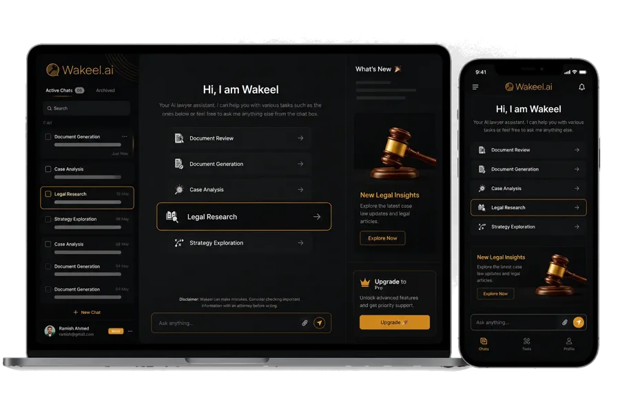
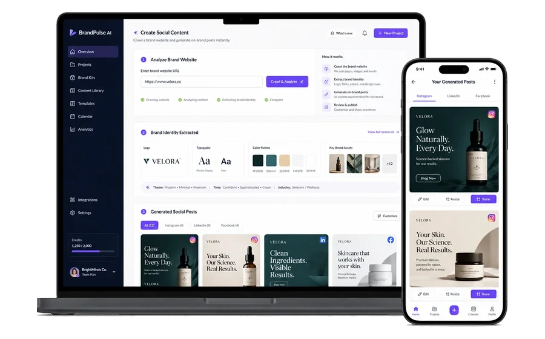
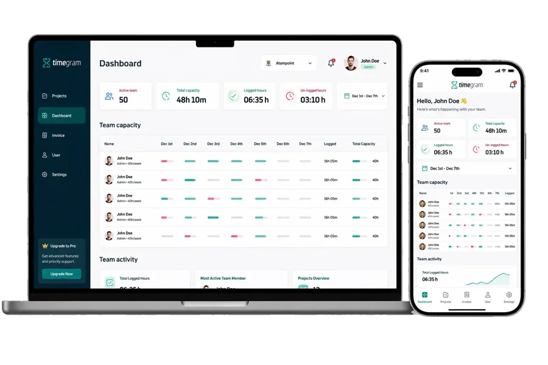

## Hi, I'm Touseef 👋

I'm a full stack developer at AtomPoint in Karachi. I build web apps and AI tools that people use every day: legal research assistants, voice agents, email systems and automations that take boring work off people's plates.

I started at AtomPoint as an intern in May 2024 and have been shipping production apps there since, alongside finishing my Software Engineering degree in 2025.

### Work I'm proud of

Most of this is company and client work, so the code is private. The products are live, so you can try them.

<table>
<tr>
<td width="50%" valign="top">

<h4><a href="https://www.wakeel.ai/">Wakeel AI</a></h4>
AI legal assistant for lawyers in Pakistan. Scrapes statutes and case law, converts them to clean text, and lets lawyers ask questions, review documents and analyse cases through a chatbot.
  Next.js · Node.js · OpenAI · Firebase
</td>
<td width="50%" valign="top">

<h4><a href="https://setup.speakto.site/">SpeakTo, voice AI agent</a></h4>
A voice agent that talks to website visitors in real time, answers their questions out loud and guides them through the site.
  Next.js · Node.js · Whisper · Realtime voice
</td>
</tr>
<tr>
<td width="50%" valign="top">

<h4><a href="https://www.gradientai.co.uk/">Gradient AI</a></h4>
Multi-tenant education analytics SaaS for UK schools. Gemini pulls topics out of exam papers, then maps every student's marks to show weak topics and at-risk students.
  Next.js · NestJS · PostgreSQL · Supabase · Gemini
</td>
<td width="50%" valign="top">

<h4><a href="https://hub.trysimpl.ai/">AI Email Manager</a></h4>
Sorts incoming mail into labels like To Respond and FYI, writes draft replies, and traces every LLM call in Langfuse so token cost stays visible.
  Node.js · OpenAI · Langfuse · MongoDB
</td>
</tr>
<tr>
<td width="50%" valign="top">

<h4>HR Workflow Automation</h4>
Replaced email and spreadsheets for a 30-person company. Attendance, leave, WFH requests, approvals and reports all run from Slack.
  Node.js · Slack API · Cloud Functions · Firestore · OpenAI
</td>
<td width="50%" valign="top">

<h4>AI Social Media Generator</h4>
Give it a company's website and it pulls out the brand colours, fonts and logo, then generates on-brand posts for every platform.
  Next.js · Supabase · Gemini · Firecrawl
</td>
</tr>
<tr>
<td width="50%" valign="top">

<h4><a href="https://stage-fe--backstage-solutions-us.us-central1.hosted.app/en/home">Backstage</a></h4>
English and Arabic talent marketplace connecting creative talent with production companies, with real-time translation and AI job matching.
  Next.js · Node.js · MongoDB · OpenAI · i18n / RTL
</td>
<td width="50%" valign="top">

<h4><a href="https://www.timegram.io/">Timegram</a></h4>
Time tracking and team capacity platform for remote teams, with dashboards, logging, invoicing and project tracking.
  Next.js · Node.js · MongoDB · TypeScript
</td>
</tr>
</table>

**Also built:** [Steelink](https://steelink.com.pk/) (corporate site, Next.js) · WhatsApp AI bot for restaurants that takes reservations and payments (Node.js, Groq, n8n) · WhatsApp lead qualification bot for real estate (Node.js, Gemini, n8n)

### What I work with

### What people I work with say

> "He understands requirements quickly, asks the right questions, and takes ownership of his work instead of just completing tasks for the sake of it."
>
> **Rai Muhammad Rafay**, Technical Project Manager, AtomPoint

---

On GitHub since 2023 · 1,400+ contributions, most of them in private company repos.
