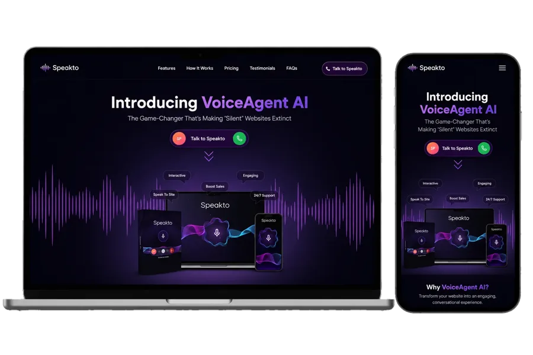
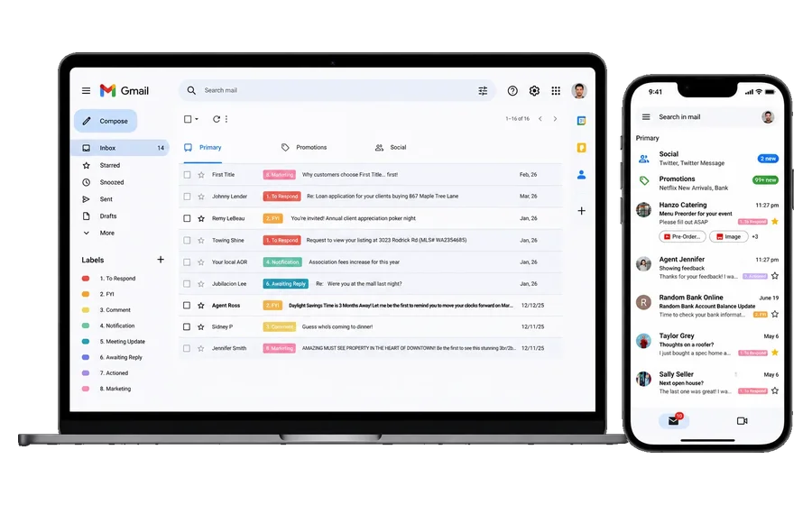
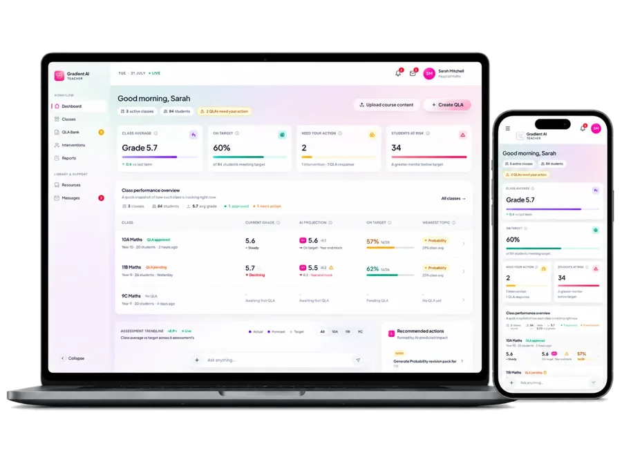
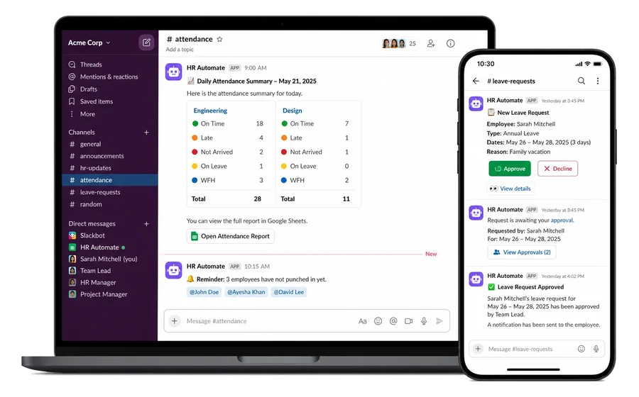

## Hi, I'm Touseef 👋

I'm a full stack developer at AtomPoint in Karachi. Most of my work is putting AI into real products: an MCP server and WhatsApp agent for a legal platform, a real-time voice agent, an AI inbox, and the backends that keep them reliable.

I started at AtomPoint as an intern in May 2024 and have been shipping production apps there since, alongside finishing my Software Engineering degree in 2025.

### Work I'm proud of

Most of this is company and client work, so the code is private. The products are live, so you can try them.

<table>
<tr>
<td width="50%" valign="top">

<h4><a href="https://www.wakeel.ai/">Wakeel AI</a>, legal case management</h4>
MCP · Gemini · WhatsApp · Google Cloud Run · Next.js
<ul>
<li>MCP server with OAuth so lawyers can work with their case data from ChatGPT and Claude</li>
<li>One shared AI tool layer for ChatGPT, Claude and WhatsApp: every write needs confirmation, each firm sees only its own data, every AI change is logged</li>
<li>WhatsApp agent on Gemini that understands voice notes and replies in the user's language</li>
<li>Moved production from Heroku to Cloud Run with zero data loss</li>
</ul>
</td>
<td width="50%" valign="top">

<h4><a href="https://setup.speakto.site/">SpeakTo</a>, real-time voice agent</h4>
Gemini Live API · Next.js · Express + WebSockets · Firecrawl · Expo
<ul>
<li>Talks to website visitors in real time and answers from the site's own pages</li>
<li>Moves the visitor around the site and highlights things on the page while it talks</li>
<li>Rebuilt audio playback as a continuous 24 kHz audio worklet to fix broken-up audio</li>
<li>Hands off to a human via Chatwoot or WhatsApp, with Stripe billing and a mobile app</li>
</ul>
</td>
</tr>
<tr>
<td width="50%" valign="top">

<h4><a href="https://hub.trysimpl.ai/">Simpl</a>, AI email manager</h4>
Node.js · Cloud Functions · MongoDB · GPT-5.1 · Gemini · Langfuse
<ul>
<li>Sorts incoming Gmail and Outlook mail and writes draft replies</li>
<li>Rules run before the AI is called, which cuts LLM cost</li>
<li>Langfuse tracing and a cost calculator on every LLM call</li>
<li>Stripe subscriptions, encryption and unit tests</li>
</ul>
</td>
<td width="50%" valign="top">

<h4><a href="https://www.gradientai.co.uk/">Gradient AI</a>, education analytics</h4>
NestJS · Prisma · PostgreSQL · BullMQ · Gemini · Next.js
<ul>
<li>Gemini pulls topics out of exam papers, with every result checked and retried if wrong</li>
<li>Mark analysis engine that finds weak topics and at-risk students</li>
<li>Row-level security, BullMQ queues, Stripe billing, audit logs, 81 unit tests and CI</li>
</ul>
</td>
</tr>
<tr>
<td width="50%" valign="top">

<h4>HR Slack bot</h4>
Node.js · Slack API · Cloud Functions · OpenAI
<ul>
<li>Leave, work from home and approval flows inside Slack</li>
<li>Monthly attendance reports for a 30-person company</li>
<li>Unlocks the office gate from Slack</li>
</ul>
</td>
<td width="50%" valign="top">

<h4>AI social image generator</h4>
Next.js · Gemini · OpenAI · Firecrawl
<ul>
<li>Pulls a brand's look from any URL and makes a 5-slide carousel</li>
<li>AI paints only the background, then the real fonts, colours and logo go on top, so it looks professional</li>
</ul>
</td>
</tr>
</table>

### More work

- **Alsahm**, investing platform for the Oman stock exchange. One NestJS API serves the website, the Expo mobile app and the admin panel, in English and Arabic. Paper trading, a trading competition, watchlists, price alerts and live market data.
- **WhatsApp sales layer.** Self-hosted Evolution API connected to Chatwoot, with rules for routing each conversation to a salesperson, a sales panel, and tracking which ad each lead and sale came from.
- **[Backstage](https://stage-fe--backstage-solutions-us.us-central1.hosted.app/en/home)**, English and Arabic talent marketplace with AI job matching.
- **[Timegram](https://www.timegram.io/)**, time tracking and team capacity platform for remote teams.
- **Client websites in Next.js:** THK (with Strapi CMS), Lakewise, [Steelink](https://steelink.com.pk/) and the AtomPoint AI agents site.

### Open source

**[Dograh](https://github.com/dograh-hq/dograh)**, an open-source voice AI platform built on Pipecat. Five merged features in its embed widget: `onTranscript`, `onToolCall`, `sendText`, `updateContext`, and choosing a text-to-speech voice per session.

### What I work with

**Languages:**

**Frontend & mobile:**

**Backend & data:**

**AI:**

**Automation & messaging:**

**Cloud & tools:**

### What people I work with say

> "He understands requirements quickly, asks the right questions, and takes ownership of his work instead of just completing tasks for the sake of it."
>
> **Rai Muhammad Rafay**, Technical Project Manager, AtomPoint

---

On GitHub since 2023 · 1,400+ contributions, most of them in private company repos.
